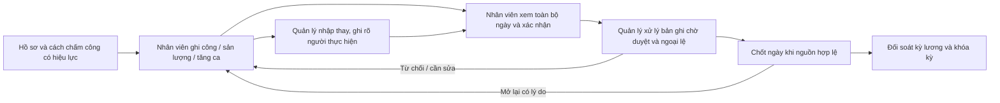

# Kế hoạch thiết kế lại luồng chấm công

Ngày lập: 2026-10-16. Phạm vi: CRM local, màn `Chấm công của tôi` và workspace chấm công của quản lý. Đây là kế hoạch; chưa thay đổi logic hay dữ liệu vận hành.

## Quyết định thiết kế

Nhân viên **tự ghi công và sản lượng là chính**; quản lý **nhập thay khi cần**, rồi xử lý nguồn chờ duyệt. Mỗi vai trò cần một điểm bắt đầu rõ ràng:

- Nhân viên mở `Hôm nay`, thấy cách chấm công đang áp dụng, dữ liệu đã ghi và **một việc tiếp theo**. Khi sửa/nghỉ/tăng ca thì mở từ đúng ngày đó. `Công của tôi` dùng để tra cứu tháng; `Thu nhập` dùng để xem số đã duyệt theo quyền.
- Quản lý mở `Cần xử lý`, thấy việc theo **nhân sự × ngày** và thứ tự ưu tiên. `Theo ngày` để rà cả tổ; `Theo tháng` để xem độ phủ và đối soát. `Lịch sử`, xuất file, cấu hình là công cụ phụ.
- Giữ ba sự kiện nghiệp vụ tách biệt: **ghi nhận nguồn**, **duyệt nguồn công/sản lượng/tăng ca**, **nhân viên xác nhận và quản lý chốt ngày**. Khóa kỳ lương là bước sau. Giao diện có thể rút thao tác, nhưng không được gộp nhầm các sự kiện hoặc tự động duyệt.



## Vì sao luồng hiện tại khó dùng

| Vấn đề quan sát từ mã nguồn | Hệ quả | Cách sửa |
| --- | --- | --- |
| `MyAttendancePage.tsx` đặt form ghi công, trạng thái ngày, việc sản xuất, thu nhập, tăng ca và lịch sử trên một trang dài; bộ chọn tháng ở gần cuối. Ngày ghi công, ngày tăng ca và tháng lịch sử độc lập. | Dễ thao tác sai ngày và không biết bước tiếp theo. | Một ngữ cảnh ngày ở đầu `Hôm nay`; chuyển ngày giữ ngữ cảnh. Tách tra cứu tháng và thu nhập thành chế độ riêng. |
| Nút xác nhận ngày nằm gần thu nhập sản lượng, trong khi xác nhận liên quan toàn bộ công, sản lượng, tăng ca và trạng thái ngày. | Nhân viên dễ xác nhận khi chưa xem đủ dữ liệu. | Đặt nút dưới bản tóm tắt toàn ngày, kèm những nguồn còn chờ/từ chối và trạng thái xác nhận. |
| `AttendanceWorkspaceV2.tsx` đặt nhiều badge/trạng thái và 4–6 hành động trên cùng hàng; tab ngày, tháng, lịch sử, tăng ca ngang cấp. | Quản lý phải tự suy luận ưu tiên và lần lượt mở nhiều hộp thoại. | Hàng đợi `Cần xử lý` mặc định; một chi tiết người/ngày với timeline, nút chính theo trạng thái, thao tác hiếm trong menu. |
| `attendance-workspace.ts` tính `hasPending` từ công và sản lượng, chưa gồm tăng ca; duyệt hàng loạt lại gồm tăng ca. | Số chờ duyệt giữa các khu vực có thể lệch. | Một read model người/ngày duy nhất gồm cả ba nguồn, công khai đơn vị đếm: **người/ngày** và **bản ghi**. |
| Bộ lọc `Chưa chấm công` suy từ không có bản ghi trên mọi ngày trong tháng, gồm ngày tương lai/ngày nghỉ; chưa có lịch làm việc từng ngày. | Có thể gắn nhãn thiếu công hoặc vắng mặt sai. | Trước khi có lịch ca, dùng `Chưa ghi nhận` trung tính; chỉ cảnh báo `Cần bổ sung` khi có căn cứ lịch/được giao việc rõ ràng. |
| Danh sách tổng hợp lọc `is_active` hiện tại. | Có thể không thấy nhân sự đã nghỉ khi xem tháng cũ. | Danh sách kỳ lấy người có hiệu lực trong kỳ **hoặc** có nguồn trong kỳ, theo phạm vi quyền. |
| Bulk approval lấy toàn tháng + tổ + tìm kiếm, không theo bộ lọc trạng thái/hình thức đang nhìn. | Người dùng có thể hiểu nhầm tập sẽ được duyệt. | Preview tập nguồn thật, số người/ngày/bản ghi và các bộ lọc được/không được áp dụng; chỉ xác nhận sau khi kiểm tra scope. |
| Việc nhận/báo cáo sản xuất chen giữa form chấm công; còn có nhập sản lượng thủ công. | Dễ tưởng phải nhập hai lần. | Trong `Hôm nay` chỉ có thẻ tiến độ và liên kết sang việc sản xuất, nêu rõ nguồn sản lượng nào đã được ghi nhận. |

Các phát hiện trên dựa trên luồng mã local tại `src/pages/MyAttendancePage.tsx`, `src/components/AttendanceWorkspaceV2.tsx`, `src/lib/attendance-workspace.ts`, `src/components/MyProductionDispatch.tsx` và `server/index.ts`; chưa thay thế cho kiểm thử trực tiếp với nhân viên tại xưởng.

## Mô hình trạng thái dễ hiểu

Mỗi người/ngày có **một nhãn hành động chính** trên danh sách; chi tiết vẫn hiện các lớp nghiệp vụ độc lập:

| Nhãn bề mặt | Điều kiện / hành động |
| --- | --- |
| `Chưa ghi nhận` | Chưa có nguồn hoặc trạng thái ngày; trung tính, không mặc định là vắng. |
| `Cần bổ sung` | Có căn cứ phải có dữ liệu nhưng thiếu, hoặc ngày đã có dữ liệu chưa đầy đủ; nêu rõ thiếu gì. Chỉ dùng tiêu chí lịch ca sau khi có lịch được duyệt. |
| `Chờ duyệt` | Ít nhất một bản ghi công, sản lượng **hoặc tăng ca** đang `SUBMITTED`; nêu số theo loại. |
| `Cần sửa` | Có nguồn bị từ chối, xác nhận đã cũ, hoặc mâu thuẫn cần người chịu trách nhiệm xử lý; chỉ rõ người cần làm tiếp. |
| `Chờ xác nhận` | Nguồn đã đủ để nhân viên xem nhưng ngày chưa được nhân viên xác nhận, theo chính sách xác nhận hiện hành. |
| `Có thể chốt` | Đã đạt điều kiện xác nhận, không còn nguồn chờ duyệt/mâu thuẫn, nguồn và quyền còn hiệu lực. Server phải kiểm tra lại khi chốt. |
| `Đã chốt` / `Đã khóa kỳ` | Phân biệt chốt của quản lý với khóa payroll; hiện đường mở lại/điều chỉnh và lý do bị khóa. |

Không dùng `Đủ dữ liệu` chỉ vì có một bản ghi. `PRESENT/ABSENT/PAID_LEAVE/UNPAID_LEAVE/HOLIDAY/OFF` hiện là **trạng thái ngày được ghi nhận**, không phải đơn nghỉ đã duyệt. Không hứa `PAID_LEAVE` được trả tiền: payroll hiện chặn quy tắc nghỉ hưởng lương chưa được triển khai. Với ngày tương lai hoặc chưa có lịch, không suy ra đi muộn, vắng mặt hay thiếu công.

Thứ tự hiển thị ưu tiên: lỗi/mâu thuẫn → nguồn bị từ chối → nguồn chờ duyệt → xác nhận cần làm → có thể chốt → đã chốt. Nhãn phải có giải thích `Vì sao?` trong chi tiết; số đếm tách `người/ngày cần xử lý` và `bản ghi chờ duyệt`.

## Màn hình và thao tác đích

### Nhân viên: `Hôm nay` là mặc định

```text
[Chấm công của tôi]       [Ngày 16/10  ▾]
[Phương thức: theo giờ]   [Trạng thái: cần xác nhận]

Việc cần làm: Xem lại 07:30–17:00, 1 phiếu sản lượng và 1 yêu cầu tăng ca
[Xác nhận ngày công]      [Báo sai / cần sửa]

Công & trạng thái ngày    → Chi tiết
Sản lượng từ việc sản xuất → Xem việc / báo cáo
Tăng ca                   → Xem / gửi yêu cầu

[Công của tôi]            [Thu nhập]
```

- Chỉ hiện mẫu nhập hợp lệ theo hồ sơ có hiệu lực ngày chọn: ngày/giờ/sản lượng; trường nâng cao mở khi cần. Không cho chọn phương thức không được cấu hình.
- Sau gửi, cập nhật tóm tắt và trạng thái ngay; giữ ngày đang xem khi quay lại. Nếu quản lý nhập thay, hiện `Được ghi bởi ...`, thời điểm và phần cần nhân viên kiểm tra.
- `Xác nhận ngày` đặt sau danh sách tất cả nguồn; nếu nguồn bị sửa thêm sau xác nhận, trạng thái chuyển về `Cần xác nhận lại` dựa trên phiên bản nguồn. Không để nút xác nhận hoạt động khi tải một phần dữ liệu bị lỗi.
- `Công của tôi`: bộ chọn tháng ở đầu, danh sách ngày với nhãn rõ ràng và bộ lọc `Cần tôi xử lý`; mở ngày quay về đúng ngữ cảnh. `Thu nhập`: tách đã duyệt/chờ duyệt, tuân thủ quyền xem tiền.
- Mobile 375 px: thẻ ngày một cột, nút chính dễ chạm ở cuối thẻ; không dùng bảng kéo ngang cho tác vụ hằng ngày.

### Quản lý: hàng đợi trước, báo cáo sau

```text
[Chấm công] [Tổ/cơ sở ▾] [Ngày 16/10 ▾]
[Cần xử lý 12] [Theo ngày] [Theo tháng]        [Tìm người]

Cần sửa (2) → Chờ duyệt (5) → Chờ xác nhận (3) → Có thể chốt (2)
[Tên/mã]  [Lý do cụ thể]  [Nguồn + số phiếu]  [Việc tiếp theo]

Chi tiết người/ngày:
  Tổng quan | Công | Sản lượng | Tăng ca | Trạng thái ngày | Nhật ký
  [Hành động chính theo trạng thái]  [Thao tác khác ▾] [Người tiếp theo]
```

- Bộ lọc tổ/cơ sở và ngày/tháng ở cùng vùng đầu trang; URL lưu ngữ cảnh để quay lại từ payroll đúng kỳ và người. Đổi chế độ không tự nhảy tháng về ngày 01.
- Hàng đợi chỉ hiện việc thuộc quyền người đang dùng. Mỗi dòng nói rõ **ai phải làm gì**, hạn nếu có chính sách, và nguyên nhân chặn. `Chưa ghi nhận` không chen vào hàng đợi lỗi nếu chưa có lịch ca.
- Quản lý nhập thay trong chi tiết người/ngày, thấy hình thức có hiệu lực, ghi lý do/attribution; dữ liệu mới xuất hiện ở phần nhân viên cần kiểm tra. Không biến nhập thay thành phê duyệt hay xác nhận của nhân viên một cách ngầm định.
- Sau duyệt/từ chối giữ bộ lọc và vị trí; có `Người tiếp theo`. Duyệt nguồn và chốt ngày chỉ có thể thành một nút sau khi endpoint nguyên tử và guard phía server hoàn tất. Trước đó giữ hai thao tác có nhãn riêng.
- `Theo tháng` là ma trận độ phủ, số chờ duyệt, số đã chốt và ngoại lệ; nhấp ô để vào chi tiết. Người nghỉ trong kỳ vẫn hiện khi có hiệu lực hoặc nguồn lịch sử. `Lịch sử`, xuất Excel, điều chỉnh sau chốt nằm trong `Công cụ`.
- Mobile: thẻ người/ngày và bottom sheet chi tiết; desktop 1440 px: bảng gọn, panel chi tiết bên phải; 768 px: tránh chồng bộ lọc và nút. Tất cả thao tác dùng được bằng bàn phím, có focus, nhãn và trạng thái tải/lỗi.

## An toàn dữ liệu và ranh giới nghiệp vụ

1. **Sự thật vẫn ở nguồn hiện có.** Read model tổng hợp từ attendance, production entry, overtime, day status và closure; không tạo bảng `attendance_status` song song. Bản ghi từ dispatch và nhập sản lượng thủ công phải chỉ rõ nguồn, tránh cộng trùng; legacy không tự nhập vào payroll.
2. **Chốt ngày phải kiểm tra lại ở server.** `POST /api/attendance/closures` hiện cho chuyển sang `LEADER_CONFIRMED` dù nguồn còn `SUBMITTED`; sau đó workflow nguồn có thể bị chặn. Bổ sung guard DB/API trước khi đổi UI chốt: khóa người/ngày, kiểm tra cả ba loại nguồn, xác nhận còn mới, quyền, kỳ lương chưa khóa và trạng thái hiện hành. Có test cạnh tranh và retry.
3. **Xác nhận của nhân viên gắn với dữ liệu đã xem.** `POST /api/my-attendance/day-confirm` hiện chỉ lưu ngày/trạng thái, không fingerprint nguồn. Bổ sung version/revision bao gồm công, sản lượng, tăng ca và trạng thái ngày; nguồn đổi thì yêu cầu xác nhận lại hoặc áp dụng quy tắc nghiệp vụ được phê duyệt. Quản lý không được chốt dựa vào xác nhận cũ.
4. **Thao tác gộp cần endpoint nguyên tử riêng.** Nếu thêm `Duyệt & chốt ngày`, server nhận tập nguồn/expected revision, xử lý cùng transaction, idempotency key và audit; lỗi bất kỳ rollback toàn bộ. Không làm bằng hai lời gọi browser liên tiếp. Quyền duyệt nguồn, xác nhận hộ và chốt vẫn tách; người nhập/duyệt phải hiện trong audit.
5. **Bulk approval đúng tập.** Endpoint hiện duyệt nguồn toàn tháng + tập nhân sự, gồm công/sản lượng/tăng ca, không xét filter hình thức/trạng thái UI. Preview server trả scope và số lượng ngay trước xác nhận; đổi scope thì preview hết hiệu lực. Nếu muốn `duyệt các dòng đang chọn`, cần API nhận source IDs và kiểm tra lại từng bản ghi, không dùng endpoint tháng hiện tại.
6. **Giữ bất biến có sẵn.** Phạm vi tổ/người dùng phía server, audit, idempotency, reversal append-only, khóa ngày, khóa kỳ lương và snapshot nguồn được giữ. Mở lại bắt buộc lý do; không sửa âm thầm bản đã duyệt/khóa. Lỗi trả về nêu hành động khả thi tiếp theo.

## Thứ tự triển khai đề xuất

| Đợt | Việc làm | Mã nguồn dự kiến | Điều kiện nghiệm thu |
| --- | --- | --- | --- |
| 0 — Đúng và an toàn | Bổ sung guard không chốt khi còn nguồn chờ duyệt; read model người/ngày gồm OT, thống nhất đơn vị đếm; đổi nhãn `Chưa chấm công` thành `Chưa ghi nhận`; giữ nhân sự lịch sử; thêm revision xác nhận. | `server/index.ts`, migration local mới, `src/lib/attendance-workspace.ts`, API types, isolated tests | Không chốt được ngày còn `SUBMITTED`; nguồn đổi sau xác nhận bị phát hiện; cùng dữ liệu cho cùng số đếm giữa các màn; kỳ cũ không mất người. |
| 1 — Màn nhân viên | `Hôm nay`, `Công của tôi`, `Thu nhập`; một ngữ cảnh ngày; tóm tắt nguồn, xác nhận đúng vị trí, liên kết dispatch. | `MyAttendancePage.tsx`, `MyProductionDispatch.tsx`, component ngày chung | Nhân viên tự nhập/xem/xác nhận qua một luồng; quản lý nhập thay hiện attribution; không xác nhận khi dữ liệu tải lỗi. |
| 2 — Màn quản lý | `Cần xử lý` mặc định, chi tiết người/ngày, action theo trạng thái, `Theo ngày/Tháng`, bộ lọc và URL ổn định. | `AttendanceWorkspaceV2.tsx`, components mới, route/query | Từ hàng đợi tới xử lý một người/ngày không phải tìm qua 4 tab; quay lại giữ scope; mobile không cần kéo ngang để duyệt. |
| 3 — Thao tác nhanh và báo cáo | Endpoint duyệt/chốt nguyên tử; preview bulk đúng scope; đưa lịch sử/export vào công cụ; liên kết lỗi preflight payroll tới người/ngày. | API local, migration mới, local API client, payroll deep link, tests | Không có trạng thái chốt nửa vời khi retry/race; preview và tập duyệt khớp; payroll trỏ đúng nguồn cần sửa. |
| 4 — Lịch ca và nghỉ (sau khi chốt quy chế) | Lịch làm việc theo ngày, đánh giá thiếu công có căn cứ; luồng đề nghị/duyệt nghỉ và quy tắc tính nghỉ/ngày lễ. | Schema/API/UI riêng + payroll rules | Không suy đoán vắng/nghỉ hưởng lương từ khoảng trống; kết quả payroll khớp quy chế được cung cấp. |

Đợt 0 là chặn lỗi dữ liệu cần làm trước hoặc cùng lúc với thay giao diện. Đợt 1–2 có thể thiết kế và kiểm thử prototype song song, nhưng không bật nút duyệt/chốt gộp khi đợt 3 chưa qua test. Không thay quy tắc lương, ngày nghỉ hưởng lương hoặc mẫu ngân hàng trong công việc UX này.

## Kịch bản kiểm thử và tiêu chí đo

- Nhân viên theo ngày/giờ/sản lượng: ghi nguồn đúng ngày, xem đủ nguồn, xác nhận; mạng lỗi một nguồn thì không thể xác nhận thiếu thông tin. Quản lý nhập thay, nhân viên nhìn thấy ai nhập và dữ liệu cần kiểm tra.
- Có một OT `SUBMITTED` nhưng công đã duyệt: cả hàng đợi, badge ngày và preview bulk đều phản ánh OT. Ngày không được chốt trước khi xử lý OT.
- Nguồn được thêm/sửa sau xác nhận: hiện `Cần xác nhận lại`; hai người duyệt/chốt đồng thời hoặc retry cùng idempotency key không tạo trạng thái nửa vời.
- Ngày mai, cuối tuần không lịch, người vào/nghỉ giữa kỳ, người đã thôi hoạt động nhưng có dữ liệu tháng cũ: nhãn và danh sách không suy diễn vắng hoặc giấu dữ liệu lịch sử.
- Bulk với lọc tổ/tìm kiếm/trạng thái: preview chỉ rõ tập thật sẽ duyệt; đổi filter/scope trước xác nhận buộc tải lại preview. Quyền bị thu hồi giữa lúc mở trang và bấm nút phải bị server từ chối an toàn.
- Ngày bị từ chối, đã chốt, mở lại có lý do, kỳ payroll đã khóa, dữ liệu sản xuất legacy: thông báo và đường xử lý đúng, không sửa bản gốc hoặc cộng trùng.
- Test ở 375/768/1440 px, bàn phím, loading/empty/error/retry. Thử nghiệm với ít nhất một nhân viên và một quản lý trên dữ liệu staging: họ tìm được hành động tiếp theo mà không cần giải thích; đo số bước và thời gian hoàn thành trước/sau trên cùng các kịch bản, không đặt ngưỡng tùy ý trước khi có baseline.

Quyết định được người vận hành xác nhận ngày 2026-10-17: **quản lý được xác nhận thay nhân viên, bắt buộc ghi lý do**. Luồng này phải hiển thị rõ là xác nhận thay, lưu người thực hiện/lý do và phiên bản nguồn; không được tạo sự kiện giả rằng nhân viên đã tự xác nhận. Quyết định này không tự cấp thêm quyền xác nhận thay cho tổ trưởng hoặc vai trò khác.
