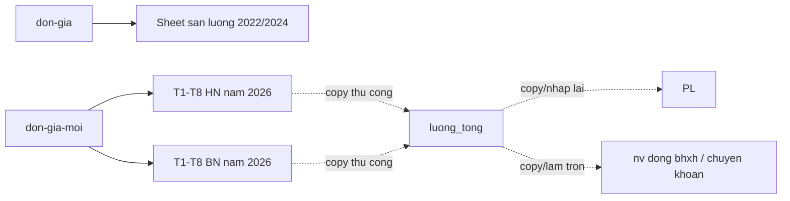

# LUONG DU LIEU EXCEL HIEN TAI

Nguon: `Copy of luong_2026 (1).xlsx`  
Muc dich: mo ta dung workbook hien tai de thay the quy trinh nhap lai cuoi thang.

## 1. Ban do workbook

### 1.1 Sheet danh muc va dau ra

| Sheet | Trang thai | Vai tro |
|---|---|---|
| `DGBN` | An | Bang gia may BN cu, 84 dong, bo cuc A:D; khong thay sheet 2026 tham chieu |
| `don-gia` | An | Bang gia cu cho cac sheet 2022/2024; co ma trung va mot gia xung dot |
| `don-gia-moi` | Hien | Bang gia cong dang dung cho 16 sheet 2026, 126 ma |
| `luong_tong` | Hien | Tam block luong thang 1-8/2026; tong hop thu cong tu san luong va cham cong |
| `PL` | Hien | 29 vung phieu luong thang 8; khong link `luong_tong` |
| `nv đóng bhxh` | Hien | Danh sach nhom BHXH/khong BHXH va chuyen khoan; khong link payroll |

### 1.2 Sheet san luong 2026 dang hien

| Co so | Cac sheet | Vai tro |
|---|---|---|
| HN | `T1(HN)`, `T2(HN)`, `T3(HN)`, `T4(HN)`, `T5(HN)`, `T6(HN)`, `T7(HN)`, `T8(HN)` | San luong va cong san pham thang 1-8/2026 |
| BN | `T1(BN)`, `T2(BN)`, `T3(BN)`, `T4(BN)`, `T5(BN)`, `T6(BN)`, `T7(BN)`, `T8(BN)` | San luong va cong san pham thang 1-8/2026 |

### 1.3 Sheet lich su 2022 dang an

| Co so | Cac sheet | Vai tro |
|---|---|---|
| HN/khong ghi ro | `T1`, `T2`, `T3`, `T4`, `T5` | San luong thang 1-5/2022 |
| BN | `T1BN`, `T2BN`, `T3BN`, `T4BN`, `T5BN` | San luong thang 1-5/2022 |

### 1.4 Sheet lich su 2024 dang an

| Co so | Cac sheet | Vai tro |
|---|---|---|
| HN | `1 HN`, `2 HN`, `3 HN`, `4 HN`, `5 HN`, `6 HN`, `7 HN`, `8 HN`, `9 HN`, `10 HN`, `T11 HN`, `T12 HN` | San luong thang 1-12/2024 |
| BN | `T1 BN`, `T2 BN`, `T3 BN`, `T4 BN`, `T5 BN`, `T6 BN`, `T7 BN`, `T8 BN`, `T9BN`, `T10 BN`, `T11 BN`, `T12 BN` | San luong thang 1-12/2024 |

Tong cong: 56 sheet, khop metadata workbook.

## 2. Quan he cong thuc



Duong lien net dut la thao tac con nguoi, khong phai tham chieu Excel. Khong co cross-sheet formula tu `luong_tong` sang `PL` hoac `nv đóng bhxh`.

## 3. Cau truc sheet san luong

### HN thang 8

| Cot | Noi dung |
|---|---|
| A | Don so |
| B | Ma hang |
| C | Mat hang, thuong tra tu `don-gia-moi` |
| D | Don gia, thuong tra tu `don-gia-moi` |
| E | SL don |
| F | SL may |
| G | Lech = SL don - SL may |
| H:K | San luong bon nguoi |
| L:O | Thanh tien bon nguoi |

Loi cau truc: F chi `SUM(H:J)`, bo cot K (`[Excel: T8(HN)!F4]`).

### BN thang 8

| Cot | Noi dung |
|---|---|
| A:G | Giong HN |
| H:M | San luong sau nguoi |
| N:S | Thanh tien sau nguoi |

F dung `SUM(H:M)` nen bao du sau nguoi (`[Excel: T8(BN)!F4]`).

## 4. Luong du lieu theo mot dong san luong

```text
Don so + ma hang + SL don + SL tung nguoi
  -> VLOOKUP ten hang
  -> VLOOKUP don gia
  -> tong SL may
  -> lech voi SL don
  -> san luong moi nguoi × don gia
  -> tong cot thanh tien moi nguoi cuoi thang
```

Workbook khong co cac truong can thiet cho mot giao dich hang ngay:

- ngay lam;
- employee ID;
- production entry ID;
- production order line ID;
- status/approval;
- created_by/approved_by;
- applied rate version;
- adjustment/reversal link.

## 5. Luong du lieu `luong_tong`

Block thang 8 la hang 248-280.

| Cot | Nghiep vu hien tai |
|---|---|
| A | STT |
| B | Mo ta che do luong |
| C | Ten nhan vien/chi phi |
| D | Ngay cong hoac gio cong |
| E | Ngay cong chuan |
| F:G | So ngay va so tien Chu nhat/le/cong nhat |
| H:I | Gio va tien tang ca/trach nhiem |
| J | Doanh so/dien thoai/trach nhiem |
| K:L | So ngay va tien an |
| M | Luong thang, luong gio hoac cong san pham |
| N | BHXH + tam ung + loi/cat hang sai |
| O | Tong luong thanh toan |
| P | Tong bo phan |
| Q:R | Tai khoan va ngan hang |

Cot B/C dang mang nghiep vu khong co cau truc. Vi du cung cot M co the la cong thuc luong thang, luong gio, so cong san pham copy tay, hoac chi phi xuong.

## 6. Doi soat thang 8/2026

### HN

| Chi tieu | Gia tri |
|---|---:|
| Dong san luong | 287 |
| Ma hang duy nhat | 34 |
| Tong SL don dung, gom numeric text | 7.216,49 |
| Tong SL may cong thuc F | 6.235,49 |
| Tong san luong ca 4 nguoi | 6.535,49 |
| Tong lech theo F | 981 |
| Lech neu tinh ca cot K | 681 |
| Tong tien cong | 39.718.000 |
| San luong cot K bi F bo sot | 300 |
| Tien cong cot K | 970.000 |
| Nhom don + ma lap | 47 |
| Dong vuot SL don | 3 |

### BN

| Chi tieu | Gia tri |
|---|---:|
| Dong san luong | 163 |
| Ma hang duy nhat | 26 |
| Tong SL don dung, gom numeric text | 6.267 |
| Tong SL may | 6.065 |
| Tong lech | 202 |
| Tong tien cong | 41.003.250 |
| Nhom don + ma lap | 33 |
| Dong vuot SL don | 2 |

### Doi chieu cong san pham sang payroll

Tong tien cua 10 cot tho may thang 8 deu tim duoc dung so tien trong cot M cua `luong_tong`. Tuy nhien:

- 4/10 khop ten sau chuan hoa don gian.
- 6/10 phai doi chieu them biet danh, co so va so tien.

Dieu nay xac nhan copy thu cong da duoc thuc hien trong thang 8, dong thoi cho thay join bang ten khong an toan.

## 7. Tai sao tong E, F, G trong Excel trong nhu khong khop

Day khong phai chi la loi cache.

- Cac o `SL don` dau bang thang 8 luu la chuoi nhu `"400"`, `"19"`.
- `SUM(E:E)` bo qua chuoi.
- Phep tru `=E4-F4` lai ep chuoi thanh so va van tinh.

Vi vay, `SUM(G)` khong bang `SUM(E)-SUM(F)` neu `SUM(E)` bo qua numeric text. He thong moi phai validate quantity la numeric tai API/database, khong chi dinh dang giao dien.

## 8. Mapping Excel sang nguon du lieu moi

| Excel | Khai niem database | Xu ly |
|---|---|---|
| `don-gia-moi!A` | `products.sku` hoac product alias | Import va map, khong tao product trung |
| `don-gia-moi!B` | Product snapshot name | Lay tu product khi duyet entry |
| `don-gia-moi!C` | Product piece-rate version | Import co `effective_from`; khong ghi de gia cu |
| Don so | Production order/legacy reference | Map neu co, cho phep nullable trong giai do chuyen tiep |
| SL don | Planned quantity | Numeric, > 0 |
| Header ten tho | `worker_id` | Mapping mot lan bang employee code/alias |
| O san luong | Production entry quantity | Mot record/nguoi/ngay/cong viec |
| O thanh tien | Calculated amount snapshot | Server tinh; khong import nhu input neu co the tinh lai |
| `luong_tong!D:E` | Attendance + period standard | Tach input thuc te va policy |
| `F:G` | Holiday/Sunday item | Tach quantity, rule, amount |
| `H:I` | Overtime item | Tach hours, rate/multiplier, amount |
| `J` | Payroll earning adjustment | Type + reason + approval |
| `K:L` | Meal allowance | Eligibility days + policy version + amount |
| `M` | Base/hourly/piece earning | Tong tu facts; snapshot payroll line |
| `N` | Insurance/advance/deduction records | Bat buoc tach thanh tung type |
| `O` | Net pay | Server result |
| `Q:R` | Bank account | Text + bank name; mask theo quyen |
| `PL` | Payslip projection | Sinh tu locked payroll snapshot |
| `nv đóng bhxh` | Transfer export projection | Sinh tu locked payroll + bank account snapshot |

## 9. Diem kiem soat moi bat buoc

1. Khong cho quantity text vao database.
2. Khong join nhan vien bang ten.
3. Khong lay gia hien tai de tinh lai entry da duyet.
4. Khong copy thanh tien san pham vao payroll bang tay.
5. Khong gop cac khoan khau tru khac loai.
6. Khong de chi phi xuong trong danh sach nhan vien.
7. Khong cho payroll locked thay doi khi danh muc/rate thay doi.
8. Moi export phai sinh tu cung mot payroll snapshot.

