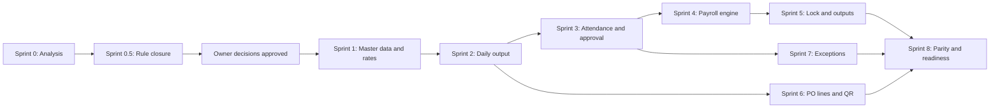

# LO TRINH TRIEN KHAI PAYROLL

Muc tieu: thay the quy trinh tinh luong Excel thu cong bang du lieu hang ngay, approval, exception va payroll snapshot.  
Nguyen tac: tung sprint nho, additive migration, co test va acceptance; khong rewrite CRM.

## 1. Trang thai hien tai

| Sprint | Trang thai | Ghi chu |
|---|---|---|
| Sprint 0 | Hoan thanh audit/thiet ke | Da hieu workbook, data flow va target architecture |
| Sprint 0.5 | Hoan thanh phan tich va owner approval | Matrix, policy spec va golden baseline da co; verdict `READY FOR SPRINT 1` |
| Sprint 1-8 | Chua bat dau trong pham vi payroll moi | Khong implement truoc khi exit criteria sprint truoc dat |

Nen CRM co the tai su dung:

- React/Vite/TanStack Query/shadcn UI;
- Supabase/PostgreSQL/Auth/RLS;
- `products`, `production_workers`, `cost_centers`;
- production orders/operations/QR;
- labor costing va factory attendance doc lap;
- `audit_events` va idempotency patterns.

## 2. Nguyen tac rollout

1. Khong sua migration da deploy; moi thay doi database la migration moi.
2. Khong dung production de test migration. Chay local/staging voi du lieu vo danh hoa.
3. Moi migration co RLS, grant, tenant validation, immutable rule va DB test lien quan.
4. Moi sprint co feature flag/route permission neu chua san sang cho tat ca nguoi dung.
5. Khong xoa/ghi de du lieu Excel cu; import luon co dry-run va report.
6. Payroll moi chay song song voi Excel it nhat mot ky pilot truoc cut-over.
7. Sai parity khong duoc sua bang lam tron tuy tien; phai tim nguyen nhan.

## 3. Sprint 0 - Excel va kien truc nghiep vu

### Muc tieu

Hieu workbook, cong thuc, manual flow, CRM boundary va cac quy tac chua ro.

### Deliverables

- `docs/payroll-business-analysis.md`
- `docs/current-excel-data-flow.md`
- `docs/payroll-formulas.md`
- `docs/proposed-workflow.md`
- `docs/database-design.md`
- `docs/implementation-roadmap.md`
- `docs/open-business-questions.md`
- `docs/payroll-erd.md`

### Ket qua

- 56 sheet, 20 hien/36 an, 66.315 formula da audit.
- Da xac dinh current price -> production -> payroll -> payslip/bank flow.
- Da phat hien loi bo sot cot, numeric text, duplicate ambiguity, deduction gop va rounding.
- Da map cac domain co the reuse/extend/new.

### Exit criteria

- Tai lieu va bang chung source day du.
- Danh sach business blocker duoc dua sang Sprint 0.5 de dong rule.

## 4. Sprint 0.5 - Business Rule Closure

### Muc tieu

Phan biet current Excel behavior voi business policy, viet rule co the code/test va chi mo Sprint 1 khi khong con gia dinh anh huong tien.

### Deliverables

- `docs/payroll-business-rule-matrix.md`
- `docs/payroll-policy-spec.md`
- `docs/payroll-golden-test-cases.md`
- cap nhat `docs/open-business-questions.md`
- cap nhat `docs/database-design.md`
- cap nhat `docs/payroll-formulas.md`
- cap nhat tai lieu nay

### Ket qua da xac minh

- Piecework: `quantity x product rate`.
- Monthly: `monthly salary / standard days x worked days`.
- Hourly: `hours x hourly rate`.
- Standard days bien doi 24/26/27/28, khong the hard-code 26.
- Special-day, overtime, meal va deduction co nhieu formula family, khong co metadata de suy ra mot policy duy nhat.
- Payroll thang 8 giu decimal `217.869.216,483516`; transfer la `217.869.217`. Da phe duyet employee-net `ROUND_HALF_UP` den VND nguyen.
- Golden baseline da co cho monthly, hourly, piecework, overtime, special day, meal, combined deduction va bank total.

### Exit criteria

1. Q1-Q4, Q5A, Q5B, Q6A va Q6B co owner decision, pham vi, ngay hieu luc va vi du.
2. Moi rule anh huong tien trong matrix la `CONFIRMED_FROM_EXCEL` hoac `OWNER_APPROVED`.
3. Khong co `ASSUMPTION` duoc dung nhu production payroll rule.
4. Golden expected cho policy da chot du de viet automated tests.
5. Formula/policy spec/database design khong mau thuan.

### Trang thai

Tai lieu Sprint 0.5 va business closure da hoan thanh ngay 2026-09-06. Owner phe duyet toan bo khuyen nghi Q1-Q4, Q5A, Q5B, Q6A, Q6B; exit criteria dat.

## 5. Sprint 1 - Employee, product, rate va RBAC foundation

### Muc tieu

Tao nguon su that cho nhan su payroll, mapping product va rate co hieu luc; chua tinh payroll.

### Scope

- Mo rong `production_workers` cho employment/location/position/status, khong tao `employees` duplicate.
- Mapping/import nhan vien va alias Excel.
- Reuse `products`; import/map `don-gia-moi` co dry-run.
- Tao product piece-rate versions theo quyet dinh Q1.
- Giu worker monthly/hourly compensation rate version.
- Tao bank account text va BHXH foundation neu rule da chot.
- Them permission/RLS cho employee/team leader/manager/accountant/admin.
- UI desktop quan ly nhan su, mapping product, rate version; mobile chi doc thong tin can thiet.

### Khong lam

- Production entry hang ngay.
- Attendance/overtime workflow moi.
- Payroll calculation, payslip, export.
- Multi-line production order.

### Database impact de kien

Additive migration cho worker fields/assignments, product piece rates, bank/BHXH va permission. Moi effective-date table co no-overlap, approve/immutable va audit.

### Tests

- Cross-tenant worker/product/rate rejected.
- Duplicate employee code/SKU mapping rejected or flagged.
- Overlapping rate version rejected.
- Effective-date resolver chon dung rate tai bien ngay.
- Rate da approved/tham chieu khong update/delete.
- Employee khong xem/sua rate, BHXH hay bank cua nguoi khac.
- Accountant/manager/team leader dung dung pham vi.
- Bank account giu zero dau va chuoi dai.

### Acceptance criteria Sprint 1

1. Q1-Q4, Q5A, Q5B, Q6A va Q6B co quyet dinh, pham vi ap dung va vi du tinh thuc te duoc phe duyet.
2. Khong co bang employee/product duplicate; tai lieu migration neu ro bang nao reuse/extend.
3. Moi nhan vien pilot co stable employee code, location, position, compensation type va status.
4. Import dry-run Excel bao tong dong, mapped, ambiguous, missing, duplicate va no-write proof.
5. Tat ca 126 product code hop le trong `don-gia-moi` duoc map hoac nam trong danh sach exception co owner.
6. Rate co effective dates, approval, no-overlap va audit; thay rate khong doi ket qua fixture lich su.
7. Tai khoan ngan hang luu text, UI mask theo quyen; khong log plaintext khong can thiet.
8. RLS test cho ADMIN, MANAGER, TEAM_LEADER/permission equivalent, EMPLOYEE va ACCOUNTANT dat.
9. Generated TypeScript types va API validation dong bo migration.
10. TypeScript, lint, build va DB tests lien quan pass.
11. Rollback/forward-fix plan va staging acceptance report hoan thanh.
12. Khong co production migration/data change neu chua duoc phe duyet rieng.

### Exit

`READY FOR SPRINT 2` khi catalog, worker mapping, rate resolver va RBAC deu duoc acceptance tren staging.

## 6. Sprint 2 - Daily production entry

### Muc tieu

Nhan vien/to truong ghi san luong ngay mot lan tai nguon; server tu tinh cong san pham.

### Scope

- `production_entries` va lifecycle DRAFT/SUBMITTED/APPROVED/REJECTED.
- Product search, recent items, assigned work; QR link neu an toan va nho.
- Server resolve rate + snapshot product/rate/amount.
- Idempotent submit va duplicate detection.
- Self entry va team-leader entry-on-behalf, actor/worker tach ro.
- History cua nhan vien va hang doi cho duyet toi thieu.

### UX chinh

Mobile form chi gom product/job, quantity va note tuy chon. Khong hien input gia/tien/ID ky thuat. Sau submit hien ket qua va status.

### Tests

- quantity numeric > 0; text/0/am bi reject;
- missing/expired/overlap rate bi block;
- same idempotency retry khong duplicate;
- amount snapshot dung tai ngay effective boundary;
- user khong tao entry cho worker ngoai quyen;
- approved row immutable;
- product/rate doi sau do khong doi entry cu.

### Exit

Mot nhom pilot ghi va duyet duoc san luong hang ngay, tong theo worker/product khop fixture, khong can copy qua payroll.

## 7. Sprint 3 - Approval, attendance, overtime va chot ngay

### Muc tieu

Hoan thien du lieu cong hang ngay va workflow kiem soat.

### Scope

- Mo rong `factory_attendance_records`, khong tao attendance duplicate.
- Ngay cong, gio vao/ra, break, leave/status theo Q7.
- Attendance approval/adjustment/reversal.
- Overtime record + approved policy theo Q3.
- Daily work closure: da chot/chua chot/cho leader.
- Production entry adjustments.
- Dashboard team leader theo ngay/to.

### Tests

- time interval, break, overnight theo policy;
- duplicate attendance per worker/date/method;
- overtime khong tu nhap amount;
- employee khong tu approve;
- late entry sau daily close tao exception;
- approved/locked fact chi sua qua adjustment;
- concurrent approvals idempotent.

### Exit

Attendance, overtime va production cua ky pilot du dieu kien tong hop ma khong nhap lai cuoi thang.

## 8. Sprint 4 - Payroll Engine

### Dieu kien vao

Q1-Q4, Q5A, Q5B, Q6A, Q6B da co policy, vi du va owner approval. Golden tests lien quan da co expected. Q7-Q15 la decision cua sprint sau; Payroll Engine chi bat dau sau khi policy assignments/rate mappings duoc dry-run va duyet.

### Muc tieu

Tinh payroll server-side tu approved facts va versioned policies.

### Scope

- Payroll periods va calculation runs append-only.
- Payroll record/item detail.
- Monthly/hourly/piece pay.
- Sunday/holiday/overtime/meal theo policy da chot.
- BHXH, allowance, advance, deduction adjustments.
- Gross, deductions, net, payment rounding.
- Input hash, formula version va reconciliation totals.

### Tests

- Unit tests tung cong thuc va rounding boundary.
- Effective-date policy/rate tests.
- Source only APPROVED, khong double count reversal.
- Negative/abnormal net tao exception, khong am tham clamp.
- Recalculate tao run moi; run cu bat bien.
- Same source fact khong xuat hien hai payroll item.

### Exit

Engine tinh duoc fixture thang pilot va giai thich tung dong payroll item; chua lock neu parity chua dat.

## 9. Sprint 5 - Preview, lock, payslip va export

### Muc tieu

Bien payroll result thanh quy trinh ke toan co audit va dau ra dung chung snapshot.

### Scope

- Preview comparison voi run truoc.
- Blocking exception gate.
- Atomic payroll lock va adjustment/off-cycle path.
- Payslip self-view.
- Export bang luong, payslip, bank transfer, production, attendance, adjustments.
- Content hash/generation audit cho export.
- Bank adapter theo Q15.

### Tests

- lock concurrent chi co mot locked run;
- master data/rate doi khong doi locked payroll;
- unlock/adjustment permission va reason;
- payslip chi worker/self va nguoi co quyen;
- export totals = locked run payment total;
- account number zero dau khong mat;
- output khong lo du lieu worker khac.

### Exit

Mot ky pilot co the preview, lock, phat phieu va export bank ma khong copy tay.

## 10. Sprint 6 - Production order lines va QR

### Muc tieu

Lien ket san luong hang ngay voi lenh/batch an toan va giam viec chon san pham.

### Scope

- `production_order_items` additive va migration/backfill an toan.
- QR token den order line/bundle, khong chua PII/gia.
- Scan -> hien san pham/ke hoach -> nhap quantity.
- Kiem soat planned vs approved output, rework/scrap.
- Legacy header compatibility cho BOM/routing/material/labor.

### Tests

- token khong doan duoc/khong cross-tenant;
- expired/inactive token;
- output khong double count header/line;
- product/rate resolver dung line va work date;
- mobile camera fallback bang search/manual selection.

### Exit

QR rut gon entry ma khong tao nguon product/order thu hai.

## 11. Sprint 7 - Reconciliation va exception dashboard

### Muc tieu

Quan ly chi xu ly truong hop bat thuong.

### Rules toi thieu

- output > planned/tolerance;
- quantity <= 0, duplicate/fingerprint;
- missing product/rate/worker/bank/BHXH;
- output co ma khong attendance va attendance khong output voi nhom piece-rate;
- worker output cao bat thuong;
- unapproved/late/modified-after-cutoff data;
- mismatch cong doan neu co;
- gross/net/payment bat thuong;
- payroll preview thay doi.

### Scope

- Rule catalog + threshold versions.
- Exception persistence, owner, resolution/waiver reason.
- Dashboard hom nay/thang nay; filter severity/team/location.
- Notification nhe, khong spam; chi action-required.

### Tests

- rule deterministic/idempotent;
- threshold effective date;
- resolve/waive audit;
- blocking exception ngan lock;
- role/team visibility.

### Exit

Quan ly co the chot ky pilot bang exception list thay vi kiem tra toan bo dong.

## 12. Sprint 8 - Parity, import va production readiness

### Muc tieu

Chung minh ket qua va chuan bi cut-over an toan.

### Scope

- Import employees, banks, products, rates voi dry-run/commit co audit.
- Fixture thang 8/2026 duoc vo danh hoa.
- `docs/excel-payroll-parity-report.md` theo tung employee/item.
- Load/performance test cho month aggregation.
- RLS/security review va backup/restore rehearsal.
- Runbook deploy, monitor, rollback/forward fix, incident handling.
- User acceptance HN/BN va training ngan.

### Parity rules

- So sanh input da xac minh, khong tin cache loi.
- Ghi Excel, system, difference, reason va disposition.
- Khong lam tron/sua fixture de PASS.
- Truong hop Excel sai phai ghi `EXPECTED DIFFERENCE`, co phe duyet; khong dua loi vao engine moi.

### Exit/cut-over

- Ky pilot parity theo nguong da phe duyet.
- Zero unresolved critical security/data-integrity finding.
- Backup va restore da test.
- Payroll owner, accountant va manager ky acceptance.
- Ke hoach song song/cut-over duoc phe duyet.

## 13. Thu tu phu thuoc

Sprint 6 co the chay sau Sprint 2 neu production architecture san sang, nhung khong duoc lam tre payroll MVP. Exception toi thieu phai co ngay tu Sprint 2-5; Sprint 7 mo rong thanh dashboard day du.

## 14. Ranh gio MVP

MVP thanh cong khi:

- nhan su/product/rate dung mot nguon;
- san luong va attendance duoc ghi/duyet hang ngay;
- payroll engine tinh tu approved facts;
- quan ly xu ly exception;
- ky luong duoc preview/lock;
- payslip va bank export sinh tu locked snapshot;
- parity voi mot ky Excel duoc giai thich.

Khong can trong MVP:

- ERP tai chinh/GL day du;
- may cham cong hardware;
- scheduling optimizer;
- mobile native app;
- import toan bo lich su 2022/2024;
- tai cau truc toan bo production order neu entry co the van hanh an toan khong order line.

## 15. Rui ro va bien phap

| Rui ro | Bien phap |
|---|---|
| Cong thuc business chua ro | blocker document + examples + approval truoc code |
| Golden test chi khop net, sai item | doi chieu tung item precise truoc gross/net/payment |
| Product/worker map sai | dry-run, alias mapping, human review ambiguous rows |
| Lich su thay doi khi rate doi | effective versions + approval snapshot + immutable facts |
| Double count payroll/costing | source link unique, reconciliation tests |
| Lo du lieu luong/bank | RLS server-side, separate view permissions, masking/audit |
| Nhap trung tren mobile | idempotency key + business duplicate rule |
| Du lieu den muon | daily closure + cutoff + exception + adjustment |
| Migration anh huong production | additive staging first, backup/restore, explicit deploy approval |

## 16. Verdict Sprint 0.5

> **READY FOR SPRINT 1**

Sprint 0.5 da hoan thanh viec phan tich workbook nhieu thang, ma tran rule, policy spec va golden baseline. Owner da phe duyet toan bo khuyen nghi ngay 2026-09-06. Sprint 1 duoc mo cho master data, product-only effective rates, policy assignment foundation va RBAC. Mapping rate/group/employee van phai dry-run, duyet va test; thieu mapping la blocking exception, khong phai ly do dung fallback.
