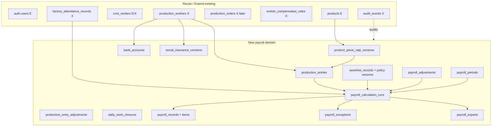
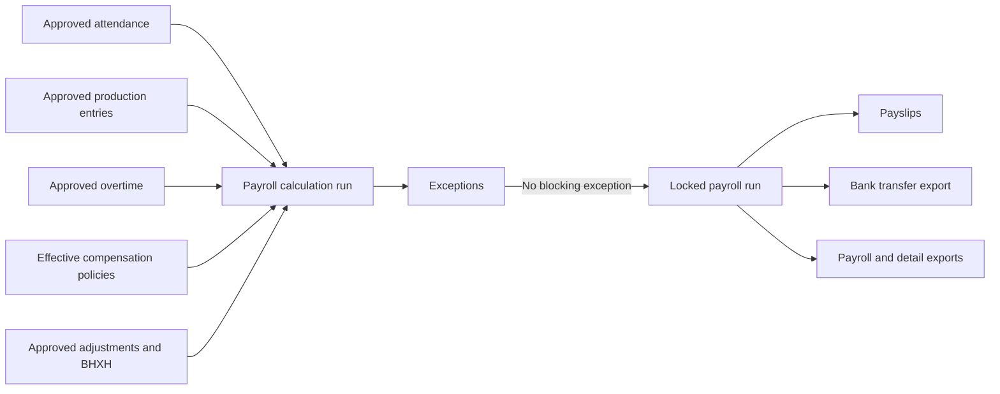

# ERD PAYROLL DE XUAT

Trang thai: mo hinh logic Sprint 0, chua phai schema da deploy.  
Ky hieu: `(E)` existing/reuse, `(X)` extend, `(N)` new.

## 1. ERD tong the

```mermaid
erDiagram
    AUTH_USERS ||--o| PRODUCTION_WORKERS : "login identity"
    COST_CENTERS ||--o{ PRODUCTION_WORKERS : "department / primary center"
    PRODUCTION_WORKERS ||--o{ WORKER_COMPENSATION_RATES : "monthly / hourly rates"
    PRODUCTION_WORKERS ||--o{ BANK_ACCOUNTS : owns
    PRODUCTION_WORKERS ||--o{ SOCIAL_INSURANCE_VERSIONS : covered_by
    PRODUCTION_WORKERS ||--o{ FACTORY_ATTENDANCE_RECORDS : attends
    PRODUCTION_WORKERS ||--o{ PRODUCTION_ENTRIES : produces
    PRODUCTION_WORKERS ||--o{ OVERTIME_RECORDS : works
    PRODUCTION_WORKERS ||--o{ DAILY_WORK_CLOSURES : confirms

    PRODUCTS ||--o{ PRODUCT_PIECE_RATE_VERSIONS : priced_by
    PRODUCTS ||--o{ PRODUCTION_ENTRIES : output_for
    PRODUCTION_ORDERS ||--o{ PRODUCTION_ORDER_ITEMS : contains
    PRODUCTS ||--o{ PRODUCTION_ORDER_ITEMS : plans
    PRODUCTION_ORDER_ITEMS o|--o{ PRODUCTION_ENTRIES : receives
    PRODUCT_PIECE_RATE_VERSIONS ||--o{ PRODUCTION_ENTRIES : snapshotted_by
    PRODUCTION_ENTRIES ||--o{ PRODUCTION_ENTRY_ADJUSTMENTS : corrected_by

    FACTORY_ATTENDANCE_RECORDS ||--o{ ATTENDANCE_ADJUSTMENTS : corrected_by
    FACTORY_ATTENDANCE_RECORDS o|--o{ OVERTIME_RECORDS : supports
    OVERTIME_POLICY_VERSIONS ||--o{ OVERTIME_RECORDS : calculated_by
    MEAL_POLICY_VERSIONS ||--o{ PAYROLL_RECORD_ITEMS : calculated_by

    PAYROLL_PERIODS ||--o{ PAYROLL_CALCULATION_RUNS : calculated_as
    PAYROLL_CALCULATION_RUNS ||--o{ PAYROLL_RECORDS : contains
    PRODUCTION_WORKERS ||--o{ PAYROLL_RECORDS : paid_in
    PAYROLL_RECORDS ||--o{ PAYROLL_RECORD_ITEMS : itemizes
    PAYROLL_CALCULATION_RUNS ||--o{ PAYROLL_EXCEPTIONS : detects
    PAYROLL_CALCULATION_RUNS ||--o{ PAYROLL_EXPORTS : exports
    PAYROLL_PERIODS ||--o{ PAYROLL_ADJUSTMENTS : receives
    PRODUCTION_WORKERS ||--o{ PAYROLL_ADJUSTMENTS : assigned_to
```

## 2. Bang reuse/extend/new

## 3. Luong du lieu vao payroll snapshot

## 4. Ranh gio bat buoc

- `production_workers` la employment identity; `auth.users` chi la login identity.
- `products` la product identity; piece rate la version rieng, khong dung selling price.
- `factory_attendance_records` ghi thoi gian/ngay cong; `production_entries` ghi output.
- `production_operation_labor_facts` va `labor_cost_entries` phuc vu costing theo lenh/cong doan; payroll item phuc vu thanh toan nguoi lao dong. Khong cong truc tiep labor cost vao payslip. Neu bridge facts, phai co source link unique de khong double count.
- `payroll_records/items` la snapshot theo run; khong phai cache co the ghi de.
- Payslip va bank transfer la projection tu cung locked run.
